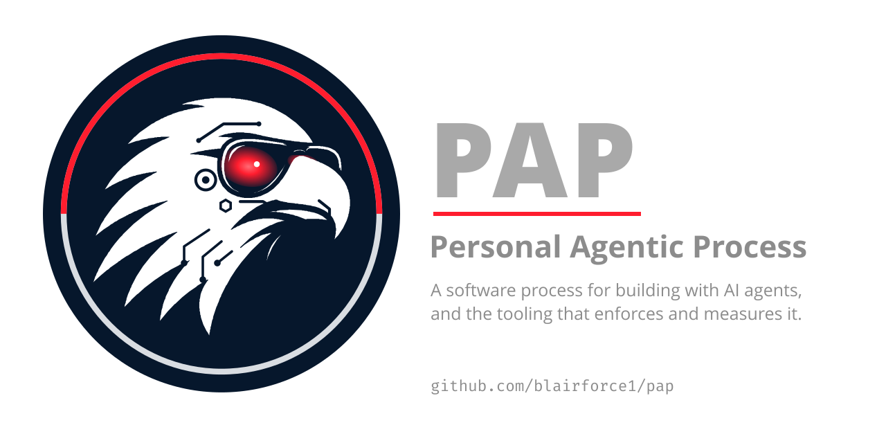

# Personal Agentic Process (PAP)

> [!IMPORTANT]
> **Work in progress.** PAP is still being built. The process document is usable; the tooling is incomplete, and anything here may change without notice.

**What it is.** A software process for one developer whose code is mostly written by AI agents, and the Claude Code tooling that enforces and measures it. You write intent and judge results; agents generate the spec, the plan, the code and the tests inside gates they cannot talk their way around. Every change is a worktree, a branch and a draft pull request with every check answered; every change to the process is a decision record that names the effect it expects and the date it will be checked.

**Why it works.** Because it measures itself and keeps what the numbers support. In its first sixteen days run as a project-manager session, PAP ran 111 agent cycles and merged 107 change pull requests across three repositories. A cycle briefed right first time cost a median 157k tokens; one that needed a message after its first report cost a median 690k, about four and a half times as much, and 19 of 108 cycles needed one. Three audits turned those misses into eleven briefing rules, now written into the process as decision 0018 (proposed), with the target that under 10% of the next twenty cycles need a second message. Each record is checked the same way, and the ones that fail are withdrawn.

**How to start.** In Claude Code, `/plugin install pap --marketplace blairforce1/pap`, then `/envision` in your repository, and for each change `/spec <slug>` once its intent is accepted, then `/change <slug> <class>` with a brief. The [quick start](#quick-start) below has the five steps.

## Where it comes from

- **[Watts Humphrey](https://en.wikipedia.org/wiki/Watts_Humphrey)'s [Personal Software Process](https://en.wikipedia.org/wiki/Personal_software_process)** showed that one engineer can measure their own work and improve it deliberately. It died on the cost of logging by hand. PAP keeps the discipline and drops the logging: every artefact already passes through git, CI and an agent session, so collection is nearly free.
- **The [Team Software Process](https://en.wikipedia.org/wiki/Team_software_process)** gave a self-directed team a launch, a plan, defined roles and a postmortem. PAP is PSP for each member and TSP for the team: the project-manager session is the team leader and coach, who launches each cycle and runs the postmortem across them, and the members are the agents, one member today, with developer, QA, research and review roles possible later. A PAP cycle is one change, much smaller than a TSP cycle, and ends at a draft pull request.
- **[Kaizen](https://en.wikipedia.org/wiki/Kaizen)**: continuous improvement through small, measured changes. In PAP a process change is an experiment with a decision record (0001), a typed revisit date that is counted, not remembered (0010), and an audit every five merged changes that turns each miss into a rule the next brief carries (0018).

Several mechanics come from Anthropic's [AI-Native SDLC Playbook](https://claude.com/resources/articles/the-ai-native-sdlc-playbook) (published 2026-08-21: a conventions file agents read, provenance on generated artefacts, an eval suite tied to process changes, merge as the trigger for the next phase); the outer-loop measures and event vocabulary come from DORA and CDEvents.

## How it works

- **Intent is the human artefact.** Humans write intent and judge results; agents generate specs, plans, code and tests from it.
- **Ceremony is proportional.** A task class sets how much specification, review and testing a change gets.
- **Every artefact records what produced it.** Model, skill version, prompt. Without provenance nothing can be attributed.
- **Escapes are attributed to a phase.** Not "a bug" but "the spec omitted a failure mode".
- **Process changes are experiments.** Written down before they start, with the outcome they are expected to move.
- **Gates are automated, not remembered.** Anything that must survive is enforced by a check that runs every time.

The full list, and the phase model, is in [the process document](process/personal-agentic-process.md). The rules a check can refuse, and what enforces each today, are in [`rules.md`](rules.md).

### Several changes at once

Decision 0018 (proposed in [#81](https://github.com/blairforce1/pap/pull/81)) records how one session runs many changes. The main session is the project manager: it restates each ask in one line and gets your yes, writes the brief, launches one background cycle per `/change`, logs every event in a committed tracker, relays what only you can decide, and runs the team postmortem, an audit of tokens and time, every five merged pull requests. It opens no pull request, approves nothing and merges nothing; those stay yours. A cycle is one change in one worktree, ending at a draft pull request and a postmortem: its report, with its cost line. A launch is the brief, the restatement and your yes; a relaunch resumes a cycle from its save point after a pause. The `pm-console` plugin puts what the cycles ask of you, the running cycles, each repository's PAP state and CI timings in a pane beside the chat.

## Quick start

1. Install the plugin in Claude Code: `/plugin install pap --marketplace blairforce1/pap`.
2. In a new or existing repository, run `/envision` to produce the product layer: vision, invariants, a hypothesis backlog and conventions.
3. Apply the template, the ruleset and the hooks with `pap init base [dotnet] [go] [risk]`; take later versions with `pap sync`. See "Adopting and syncing the template" in [`templates/base/README.md`](templates/base/README.md).
4. For each change, `/spec <slug>` once its intent is accepted: it drafts the spec with its acceptance scenarios and, for feature and infra changes, how the change is watched and undone, runs the review board and records your yes on the change branch (decision 0021). Then `/change <slug> <class>` followed by the brief. The skill makes the worktree, reads the spec, commits as it goes, runs the local checks and opens a draft pull request with every box answered. Review by risk label; on a `risk:high` pull request you have reviewed, run `/pap:reviewed <PR#> [sha7+]` to add `owner-reviewed`. Only you can invoke it.
5. To run several changes at once, make one session the project manager and give it the console: `/plugin install pm-console --marketplace blairforce1/pap`.

## What is here

| Path                                  | What it is                                                                                                                                                                                                                                         |
| ------------------------------------- | -------------------------------------------------------------------------------------------------------------------------------------------------------------------------------------------------------------------------------------------------- |
| `process/personal-agentic-process.md` | The process itself. Tool-agnostic. Says what must happen, not how.                                                                                                                                                                                 |
| `rules.md`                            | The rule register: every enforceable rule, the decision that introduced it, and what enforces it today. Gaps are written down, not hidden.                                                                                                         |
| `decisions/`                          | Decision records. Process changes are treated as measured interventions (decision 0001), so each record states the expected effect and when it will be revisited.                                                                                  |
| `plugins/pap/`                        | A Claude Code plugin: one skill per process phase (`/envision`, `/spec`, `/change`), `/reviewed` for the owner's review label, which only a person can invoke, plus hooks that enforce the rules an agent must not be able to talk its way around. |
| `plugins/spec-review/`                | A Claude Code plugin for phase 3, spec review: eleven reviewer perspectives, from security to the EU AI Act, plus `spec-review-full` to run the whole board. Works on any design document, with or without the `pap` plugin.                       |
| `plugins/pm-console/`                 | A Claude Code plugin for the project-manager session: a pane with the cycle inbox (what each cycle asks of you, grouped by pull request), the running cycles, each repository's PAP state and CI timings, and a status line.                       |
| `bin/pap`                             | The `pap` CLI: `init` and `sync` apply the template layers, `repo` and `codeowners` configure GitHub, `doctor` checks the local machine.                                                                                                           |
| `scripts/`                            | Guards shared by the git hooks and the Claude Code hooks, the template assembler and the release script.                                                                                                                                           |
| `.github/rulesets/`                   | The branch ruleset applied to every repo that adopts the process.                                                                                                                                                                                  |
| `lefthook.yml`, `mise.toml`           | Pinned local tooling. `mise install && lefthook install` is the whole setup.                                                                                                                                                                       |

## Status

Early. The process document is stable enough to use. The tooling is being built one change at a time, each through the process it enforces. Decision 0002 records the first time the written record and the repository disagreed, and how it was fixed. Repository templates beyond the base, .NET and Go layers, and the metrics pipeline, are on the roadmap; the decision records and open pull requests say what exists.

## Licence

Apache License 2.0. See [LICENSE](LICENSE).
